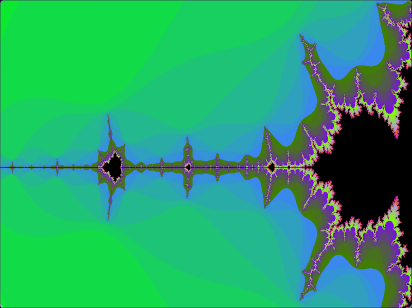
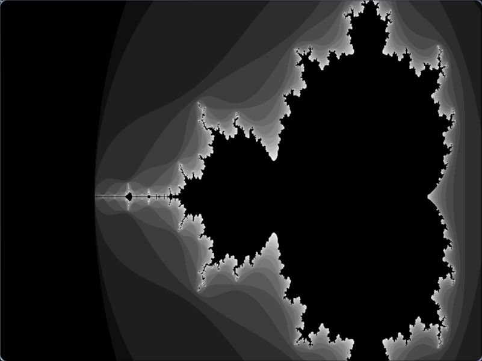
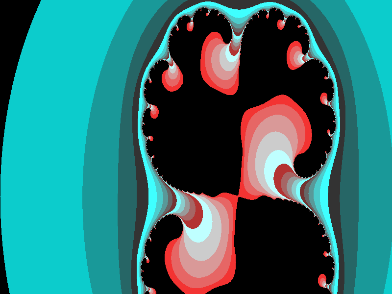
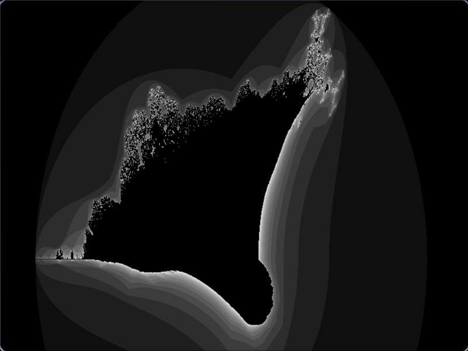
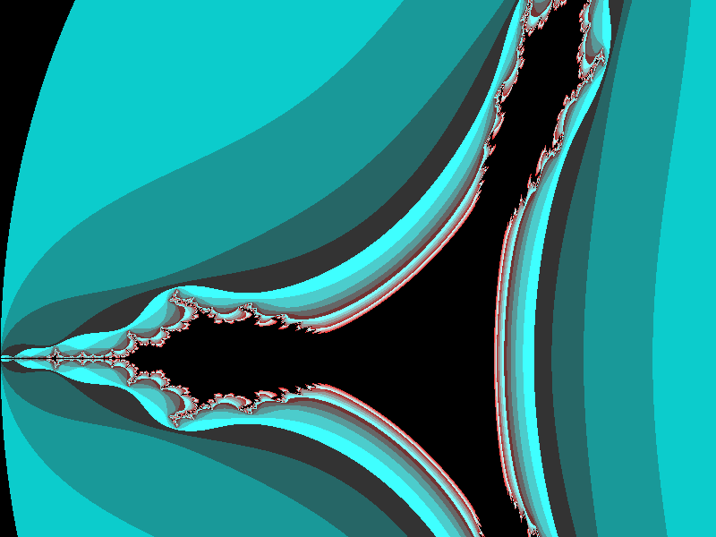
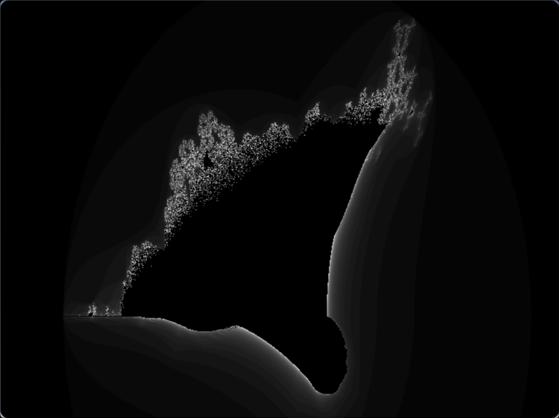

<div align="center">

# Fract-ol

**Un explorateur de fractales écrit en C, de zéro.**
**A fractal explorer written from scratch in C.**

[🇫🇷 Français](#fr) · [🇬🇧 English](#en)

</div>

---

<a id="fr"></a>

## Français

### Le projet en une phrase

Fract-ol est un petit logiciel de bureau qui dessine des **fractales** et permet de plonger dedans à la souris : on zoome, on se déplace, et de nouveaux détails apparaissent à chaque fois. Le programme est écrit en **C** et n'utilise aucune bibliothèque de calcul graphique : chaque pixel de l'image est calculé à la main, puis affiché dans une fenêtre.



*Un zoom poussé dans l'ensemble de Mandelbrot, avec un niveau de détail élevé.*

### Une fractale, c'est quoi ?

Une fractale est une forme qui se répète à des échelles de plus en plus petites. Un chou-fleur, une fougère ou une côte rocheuse en sont des exemples naturels. Les fractales mathématiques, comme l'ensemble de Mandelbrot, sont obtenues en répétant une formule très simple des millions de fois — une opération par pixel. Le résultat : une image qui semble infiniment détaillée, et qui en contient effectivement toujours plus quand on zoome.

C'est exactement ce que fait Fract-ol : pour chaque pixel de la fenêtre, il répète un calcul jusqu'à décider « ce point appartient à la figure » ou non, et colore le pixel en fonction du nombre d'étapes nécessaires.

### Quelques exemples

Toutes les images ci-dessous ont été capturées avec le programme lui-même, sans retouche.

| Ensemble de Mandelbrot | Ensemble de Julia |
|:--:|:--:|
|  |  |
| *La fractale la plus célèbre, avec un niveau de détail élevé.* | *Une variante pilotée par deux paramètres choisis en ligne de commande.* |

| Burningship (« bateau en feu ») | Tricorn |
|:--:|:--:|
|  |  |
| *Une fractale au bord déchiqueté, très contrastée.* | *Comme Mandelbrot, mais « pliée » en son milieu.* |

### Encore plus de détails

Augmenter le nombre d'itérations ne change pas la forme générale, mais affine les bords : les filaments les plus fins apparaissent, comme si l'on passait d'un croquis à un dessin très précis. C'est exactement ce que fait la touche `Page ↑` pendant que le programme tourne.

| Un premier niveau de détail | Le même, avec davantage d'itérations |
|:--:|:--:|
|  |  |
| *Le bord du Burningship…* | *… et les franges qui se précisent à chaque itération ajoutée.* |

### Ce que l'on peut faire

| Action | Commande |
|---|---|
| **Zoomer / dézoomer** | Maintenir `Ctrl` et faire tourner la molette |
| **Se déplacer** | Flèches directionnelles, ou `ZQSD` (AZERTY) / `WASD` (QWERTY) |
| **Glisser l'image à la souris** | Maintenir le clic gauche et bouger |
| **Ajouter ou retirer du détail** | `Page ↑` / `Page ↓` (une itération à la fois) |
| **Faire varier une fractale de Julia** | Touches `T` `Y` pour `z`, `U` `I` pour `c` |
| **Quitter** | `Échap` ou fermer la fenêtre |

Pendant un déplacement à la souris, le programme réduit temporairement le niveau de détail pour rester fluide, puis le rétablit au relâchement.

### Construire et lancer

```bash
git clone https://github.com/AlphanumericString/42fractol.git
cd 42fractol

nix-shell      # sur NixOS / avec Nix : fournit clang et les bibliothèques X11
make           # compile le projet et ses bibliothèques
./fractol -h   # affiche l'aide
```

Hors Nix, il faut simplement `clang`, `make` et les en-têtes X11 (`libX11`, `libXext`).

### Exemples de commandes

```bash
./fractol -h                      # aide
./fractol Mandelbrot 30           # 30 itérations
./fractol Julia -0.4 0.6          # Julia avec c = -0.4 et z = 0.6
./fractol -f Burningship 42       # clavier AZERTY, 42 itérations
./fractol -l Tricorn 20           # journal de débogage dans le terminal
```

Les options se placent **avant** le nom de la fractale. Elles sont aussi disponibles en version longue : `--help`, `--version`, `--log`, `--english`, `--french`.

### Les capacités du projet

- **5 fractales au menu** : Mandelbrot, Julia, Burningship, Tricorn et Newton (Newton est sélectionnable, voir les limites plus bas).
- **Navigation interactive** : zoom centré sous le curseur, déplacement au clavier ou à la souris, réglage du niveau de détail en direct.
- **Julia paramétrable** : on choisit les deux nombres de la formule en ligne de commande, et on les fait varier au clavier pour explorer toute une famille de figures.
- **Claviers AZERTY et QWERTY** : les touches sont traduites selon la disposition choisie.
- **Vérification des arguments** : nombres invalides, valeurs hors bornes et noms de fractales inconnus sont détectés, avec un message clair et des bornes appliquées automatiquement.
- **Mode journal** : l'option `-l` affiche en continu l'état de la caméra (position, zoom, itérations) dans le terminal.
- **Gestion propre des ressources** : fenêtre, image et structures allouées sont libérées en sortie.

### Sous le capot (pour les curieux)

- Environ 1 700 lignes de **C99** (sources et en-têtes), réparties en 25 fichiers, plus une bibliothèque maison (`libft`, 128 fichiers) développée pour les besoins du projet.
- Affichage via **miniLibX / X11** ; le rendu se fait dans une image en mémoire, ensuite envoyée à l'écran en une seule opération.
- Architecture modulaire : une structure de contexte unique, un tableau de fonctions (une fonction de calcul par fractale), un petit analyseur d'options maison inspiré de `getopt`, des « hooks » pour les événements clavier/souris.
- Compilation avec `clang` et `-Wall -Wextra -Werror` (quelques avertissements volontairement désactivés) : le projet compile sans avertissement.
- Recette `make debug` pour compiler avec les symboles de débogage, et un `shell.nix` pour un environnement reproductible.

### Valeurs par défaut

| Réglage | Valeur |
|---|---|
| Taille de la fenêtre | 800 × 600 pixels |
| Itérations | 20 (la valeur passée en argument est ramenée entre 1 et 42) |
| Zoom de départ | 1, pas de 0.01 par cran de molette, minimum 0.01 |
| Vitesse de déplacement | 1 |
| Disposition du clavier | QWERTY anglais (option `-f` pour AZERTY) |
| Paramètres de Julia | `c` puis `z` en ligne de commande, bornés entre -10 et 10 |
| Couleurs | dégradé cyan/rouge fixe selon le nombre d'itérations, intérieur noir |
| Place des options | avant le nom de la fractale |

### Ce qui manque et ce qui pourrait être amélioré

**Fractales**

- **Newton ne s'affiche pas correctement** : avec les formules actuelles, l'image sort presque entièrement noire. La correction demande de vraies itérations de Newton (divisions par la dérivée) et un cadrage adapté.
- **La fougère de Barnsley est annoncée mais absente** : elle apparaît dans le message d'usage, mais son code est commenté et son nom n'est pas reconnu à l'appel. Il manque la génération aléatoire de points et un nouveau mode de rendu (points plutôt que pixels calculés un par un).

**Rendu**

- **Pas de thèmes de couleurs** : la palette est unique et codée en dur ; plusieurs palettes (et un rendu lissé entre les bandes) donneraient un bien meilleur résultat visuel.
- **Pas d'anticrénelage** : les contours sont nets, donc crénelés en fort zoom ; un sur-échantillonnage (calculer 2 × 2 ou 4 × 4 points par pixel) réglerait cela.
- **Image légèrement étirée** : la mise à l'échelle ne conserve pas tout à fait le rapport largeur/hauteur, ce qui déforme un peu les figures. Un facteur d'échelle commun, calculé sur le plus petit côté, suffirait.
- **Zoom limité** : la précision des nombres flottants (type `double`) borne le zoom possible ; un « deep zoom » demanderait des techniques plus avancées (calcul en précision arbitraire ou perturbation).

**Interface**

- **La molette ne zoome pas toute seule** : il faut maintenir `Ctrl`. Sans `Ctrl`, la molette est censée régler la vitesse de déplacement, mais le calcul utilisé (`1 % 400`) donne toujours 1 : ce réglage est donc inopérant.
- **Le niveau de détail n'est pas borné en cours d'exécution** : les arguments sont limités entre 1 et 42, mais `Page ↑` peut dépasser cette valeur et ralentir fortement le programme.
- **Aucun export d'image** : impossible d'enregistrer une vue en PNG depuis le programme ; les captures de ce README ont été prises avec un outil externe.
- **Quelques incohérences de finition** : `-v` affiche bien la version mais termine avec un code d'erreur, l'aide décrit Tricorn comme prenant `c` et `z` alors qu'il attend un nombre d'itérations, et le message d'usage parle de `./fract_ol` alors que l'exécutable s'appelle `fractol`.

**Plateforme et outillage**

- **Linux / X11 uniquement**, à cause de miniLibX ; pas de version macOS ni Windows.
- **Aucun test automatisé ni intégration continue** : les vérifications sont manuelles. Des tests sur l'analyse des arguments et sur les formules de calcul seraient un bon point de départ.

---

<a id="en"></a>

## English

### The project in one sentence

Fract-ol is a small desktop application that draws **fractals** and lets you dive into them with your mouse: you zoom, you move around, and new details show up every time. It is written in **C** with no graphics engine involved — every pixel is computed by hand, then drawn in a window.


*A deep zoom into the Mandelbrot set, at a high level of detail.*

### What is a fractal?

A fractal is a shape that repeats itself at smaller and smaller scales. Cauliflowers, ferns and rocky coastlines are natural examples. Mathematical fractals such as the Mandelbrot set come from repeating a very simple formula millions of times — once per pixel. The result is an image that looks infinitely detailed, and actually keeps revealing more detail as you zoom in.

That is exactly what Fract-ol does: for every pixel of the window, it repeats a computation until it can tell whether the point belongs to the shape, and colors the pixel according to how many steps it took.

### Some examples

All the images below were captured with the program itself, without retouching.

| Mandelbrot set | Julia set |
|:--:|:--:|
|  |  |
| *The most famous fractal, at a high level of detail.* | *A variant driven by two parameters chosen on the command line.* |

| Burningship | Tricorn |
|:--:|:--:|
|  |  |
| *A heavily contrasted fractal with shredded edges.* | *Like Mandelbrot, but folded in the middle.* |

### Even more detail

Raising the iteration count does not change the overall shape, but sharpens the edges: the finest filaments appear, as if a rough sketch turned into a precise drawing. That is exactly what the `Page ↑` key does while the program is running.

| A first level of detail | The same, with more iterations |
|:--:|:--:|
|  |  |
| *The edge of the Burningship…* | *… and the frills that become sharper with every added iteration.* |

### What you can do

| Action | How |
|---|---|
| **Zoom in / out** | Hold `Ctrl` and scroll the wheel |
| **Move around** | Arrow keys, or `ZQSD` (AZERTY) / `WASD` (QWERTY) |
| **Drag the image with the mouse** | Hold the left button and move |
| **Add or remove detail** | `Page ↑` / `Page ↓` (one iteration at a time) |
| **Vary a Julia fractal** | `T` `Y` shift `z`, `U` `I` shift `c` |
| **Quit** | `Escape` or close the window |

While you drag with the mouse, the program temporarily lowers the level of detail to stay smooth, then restores it when you release the button.

### Build and run

```bash
git clone https://github.com/AlphanumericString/42fractol.git
cd 42fractol

nix-shell      # on NixOS / with Nix: provides clang and the X11 libraries
make           # builds the project and its libraries
./fractol -h   # shows the help
```

Outside Nix, you only need `clang`, `make` and the X11 headers (`libX11`, `libXext`).

### Command examples

```bash
./fractol -h                      # help
./fractol Mandelbrot 30           # 30 iterations
./fractol Julia -0.4 0.6          # Julia with c = -0.4 and z = 0.6
./fractol -f Burningship 42       # AZERTY keyboard, 42 iterations
./fractol -l Tricorn 20           # debug log in the terminal
```

Options go **before** the fractal name. Long versions are also available: `--help`, `--version`, `--log`, `--english`, `--french`.

### What the project can do

- **5 fractals on the menu**: Mandelbrot, Julia, Burningship, Tricorn and Newton (Newton is selectable — see the limitations below).
- **Interactive navigation**: zoom centered on the cursor, keyboard or mouse panning, live control of the level of detail.
- **Configurable Julia sets**: both numbers of the formula are given on the command line, and can be shifted with keys to explore a whole family of patterns.
- **AZERTY and QWERTY keyboards**: keys are translated according to the layout you choose.
- **Argument checking**: invalid numbers, out-of-range values and unknown fractal names are caught with clear messages, and values are clamped automatically.
- **Log mode**: the `-l` option continuously prints the camera state (position, zoom, iterations) to the terminal.
- **Clean resource handling**: window, image and allocated structures are freed on exit.

### Under the hood (for the curious)

- About 1,700 lines of **C99** (sources and headers) across 25 files, plus a home-made library (`libft`, 128 files) written for the project.
- Display through **miniLibX / X11**; rendering happens in an in-memory image that is then sent to the screen in a single operation.
- Modular design: a single context structure, a function table (one computation per fractal), a small hand-written option parser inspired by `getopt`, and hooks for keyboard and mouse events.
- Built with `clang` and `-Wall -Wextra -Werror` (a few warnings deliberately disabled): the project compiles without a warning.
- A `make debug` recipe adds debug symbols, and a `shell.nix` provides a reproducible development environment.

### Defaults

| Setting | Value |
|---|---|
| Window size | 800 × 600 pixels |
| Iterations | 20 (a command-line value is clamped between 1 and 42) |
| Starting zoom | 1, step of 0.01 per wheel notch, minimum 0.01 |
| Movement speed | 1 |
| Keyboard layout | English QWERTY (`-f` for AZERTY) |
| Julia parameters | `c` then `z` on the command line, clamped between -10 and 10 |
| Colors | fixed cyan/red gradient based on the iteration count, black inside |
| Option position | before the fractal name |

### What is missing and what could be improved

**Fractals**

- **Newton does not render properly**: with the current formulas the image comes out almost entirely black. Fixing it needs real Newton iterations (dividing by the derivative) and a suitable framing.
- **The Barnsley fern is advertised but absent**: it appears in the usage message, but its code is commented out and its name is not accepted. It needs random point generation and a new rendering mode (points rather than a computed pixel grid).

**Rendering**

- **No color themes**: there is a single hard-coded palette; several palettes (and smooth coloring between bands) would look much better.
- **No anti-aliasing**: edges are crisp, hence jagged when zoomed in; supersampling (computing 2 × 2 or 4 × 4 points per pixel) would solve it.
- **Slightly stretched image**: the coordinate scaling does not quite preserve the aspect ratio, so shapes are a little distorted. A single scale factor based on the shortest side would fix it.
- **Limited zoom depth**: floating-point (`double`) precision caps how far you can zoom; deep zoom would require more advanced techniques (arbitrary precision or perturbation).

**Interface**

- **The wheel does not zoom on its own**: `Ctrl` must be held. Without `Ctrl`, the wheel is meant to adjust the movement speed, but the computation used (`1 % 400`) always yields 1, so that control does nothing.
- **The level of detail is not clamped at runtime**: command-line arguments are limited to 1–42, but `Page ↑` can go past that and slow the program down heavily.
- **No image export**: a view cannot be saved as a PNG from the program; the screenshots in this README were taken with an external tool.
- **A few rough edges**: `-v` prints the version but exits with an error status, the help text describes Tricorn as taking `c` and `z` although it takes an iteration count, and the usage message mentions `./fract_ol` while the executable is named `fractol`.

**Platform and tooling**

- **Linux / X11 only**, because of miniLibX; there is no macOS or Windows build.
- **No automated tests and no continuous integration**: checks are manual. Tests on argument parsing and on the computation formulas would be a good starting point.

---

<div align="center">

*Made as part of the 42 school curriculum.*

</div>
